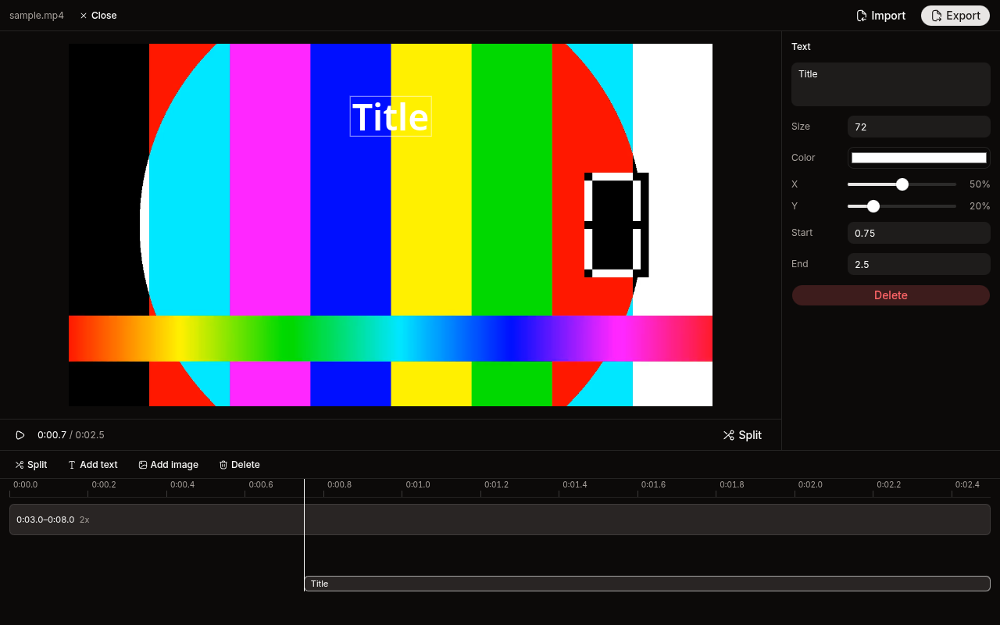

<p align="center">
  
</p>

<h1 align="center">Editor</h1>

<p align="center"><strong>A small desktop video editor. Cut, trim, add a title, export.</strong></p>

<p align="center">
  
  
</p>

<p align="center">
  
</p>

Open a video, cut it into clips, and export an MP4. Editor keeps every video you open in a local library, so your edits are there the next time you open the same file.

## Install

Download the installer for your OS from [Releases](https://github.com/sankalpaacharya/editor/releases): an `.exe` for Windows, a `.dmg` for macOS, or an `.AppImage` for Linux. To get a newer version later, choose **Help > Check for Updates…**.

## What you get

- Open a video with **Import** or drop it on the window
- Split at the playhead, trim clip edges, delete clips, and drag clips to reorder them
- Play each clip at 0.25x to 4x speed
- Add text overlays with size, color, position, and timing
- Add PNG or JPG image overlays with scale, position, and timing
- Drag overlays in the preview to place them
- Export to MP4 with a progress bar and **Cancel**
- Reopen recent projects with their edits, and see the exports of each video

Shortcuts: **Space** plays and pauses, **S** splits at the playhead, and **Delete** removes the selection.

The preview and the export use the same coordinates, so an overlay lands where you placed it. Text uses the bundled Noto Sans on every OS.

## Dev

You need Node.js 22 and pnpm 10.

```sh
pnpm install
pnpm dev
```

| Script            | What it does                                                 |
| ----------------- | ------------------------------------------------------------ |
| `pnpm dev`        | Starts the app with hot reload.                              |
| `pnpm typecheck`  | Type-checks the main and renderer projects.                  |
| `pnpm lint`       | Runs ESLint.                                                 |
| `pnpm test`       | Runs the vitest suite. The export test runs the real ffmpeg. |
| `pnpm build`      | Type-checks and bundles into `out/`.                         |
| `pnpm dist:linux` | Builds an AppImage into `release/`.                          |
| `pnpm dist:mac`   | Builds a dmg and a zip. Run it on macOS.                     |
| `pnpm dist:win`   | Builds an NSIS installer. Run it on Windows.                 |

Build each installer on its own OS, because `ffmpeg-static` downloads only the binary for the OS it is installed on. The repo pins `ffmpeg-static` to `5.2.0` (ffmpeg 6.0). Later versions ship a Linux build without the `drawtext` filter, and text overlays depend on it.

## Release

Push a tag that starts with `v`, for example `v0.2.0`, after you bump `version` in `package.json`. The `Release` workflow builds the installers on Linux, macOS, and Windows and uploads them to a draft GitHub release. Publish the draft, and installed apps find the update through **Check for Updates…**.

The update check reads public GitHub releases. If the repository is private, installed apps can't see new versions. macOS installs updates only when the app is signed.

## Architecture

The data shape lives in `src/shared/project.ts`. A `Project` holds the probed source video, an ordered list of clips, and a list of overlays. Each clip is a range of the source in source seconds with a playback speed. Each overlay is either `text` or `image`, with a start and end in timeline seconds and a center position as a fraction of the frame. Every edit goes through `editProject`, a pure reducer, so the renderer and the tests run the same code.

The main process (`src/main`) owns the file dialogs, ffprobe, the export job, and the library. The renderer never sees source file paths. Main gives each opened file an asset id and serves its bytes through the `media://<asset id>/` protocol. The preload script exposes a small typed API (`src/shared/api.ts`) through `contextBridge`. The window runs with context isolation and the sandbox on, and main validates every IPC payload with the zod schemas from `project.ts`.

The library is a SQLite file (`editor.db` in the app's user data folder) opened with Node's built-in `node:sqlite`, so there is no native module to rebuild. The `videos` table stores each opened file and its edits as JSON. The `exports` table records each finished export. Opening a file that is already in the library restores its edits.

Export turns the project into one ffmpeg command (`src/main/export-args.ts`). It trims each clip, retimes it with `setpts` and `atempo`, and concatenates the clips. Then it draws text with `drawtext` and composites images with `overlay`, each gated with `enable='between(t,start,end)'`. ffmpeg reports progress through `-progress pipe:1`.

The preview plays the source `<video>` and maps the playhead from timeline time to source time with `locate`. At the end of a clip, it seeks to the start of the next one and sets the playback rate to that clip's speed.

## License

MIT. Noto Sans is under the SIL Open Font License (`resources/fonts/OFL.txt`).
